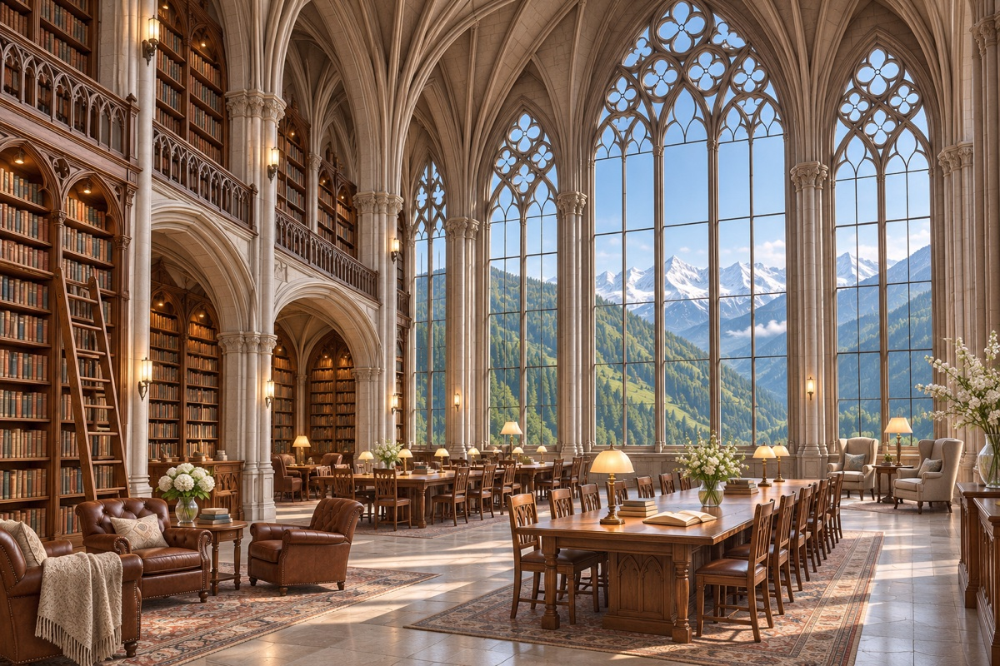
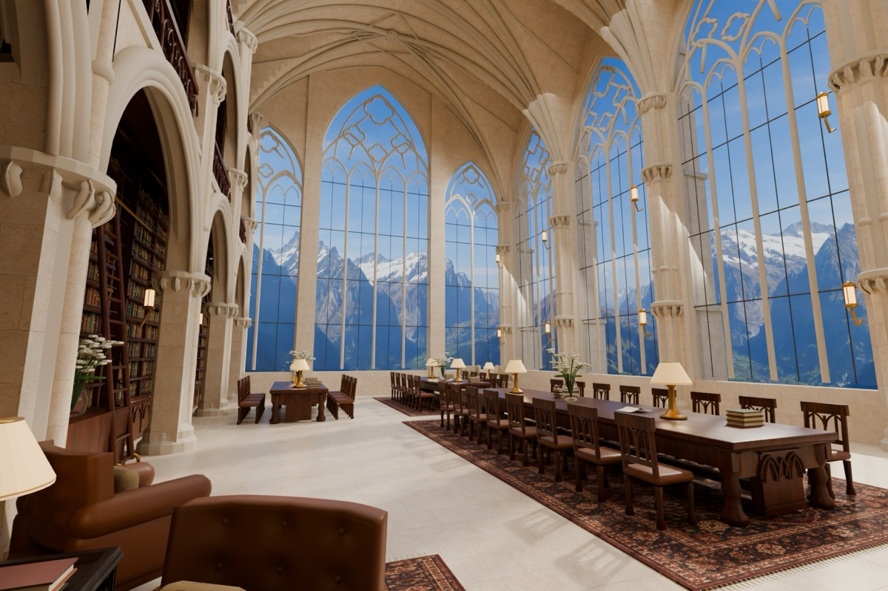
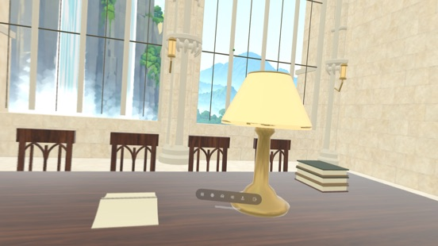
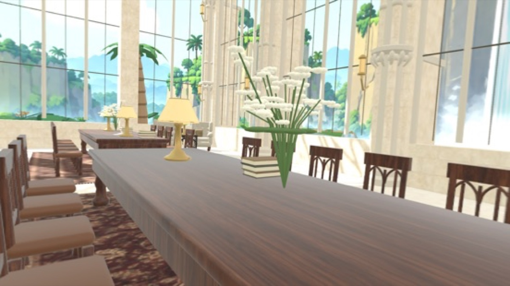

# Alpine Scriptorium — Sol 1.1.1 public example

This is the accepted first public example from the Gothic mountain-library
exercise: the original **Sol 1.1.1** result, preserved as it was reviewed. It
is an example of a concept-to-Room workflow, not a current recommended Room
template or a model ranking.

## Downloads

The files below are GitHub Release assets, rather than repository files,
because both the import archive and editable-source ZIP exceed the repository
size limit. The release tag is pinned so the links resolve to the exact
published bytes.

| File | Purpose | SHA-256 |
| --- | --- | --- |
| [`AlpineScriptorium-Sol-1.1.1.locusplace`](https://github.com/EnterLocus/locus-support/releases/download/gothic-mountain-library-sol-1.1.1/AlpineScriptorium-Sol-1.1.1.locusplace) | Original combined Room, View, and Experience import archive (114 MB) | `3c3a2ecf619751ce84ceb2f774f01b25953588bc396e024e4b99c38f695de25a` |
| [`AlpineScriptorium-Sol-1.1.1-source.zip`](https://github.com/EnterLocus/locus-support/releases/download/gothic-mountain-library-sol-1.1.1/AlpineScriptorium-Sol-1.1.1-source.zip) | Original editable Blender source, textures, scripts, package metadata, review material, and public tools (273 MB) | `aacf47b73a54c4e7abfa037d554fe6ac912f7d9e7850268417f00937f2d6d2de` |
| [`SHA256SUMS`](https://github.com/EnterLocus/locus-support/releases/download/gothic-mountain-library-sol-1.1.1/SHA256SUMS) | Hashes for both release archives | — |
| [`LICENSES.md`](https://github.com/EnterLocus/locus-support/releases/download/gothic-mountain-library-sol-1.1.1/LICENSES.md) | Component credits, license scope, and change notices | — |

Verify the downloaded archive before importing it:

```sh
shasum -a 256 AlpineScriptorium-Sol-1.1.1.locusplace
```

The expected digest is
`3c3a2ecf619751ce84ceb2f774f01b25953588bc396e024e4b99c38f695de25a`.

## What the creator asked for

The original creator brief, preserved in Chinese, was:

> 山中的一个大书库，很高的哥特式建筑。玻璃窗外是美丽的山景和远处的雪山。

English: a large library in the mountains, a very tall Gothic building, with a
beautiful mountain landscape and distant snow-capped mountains outside the
glass windows.

The English [agent brief](agent-brief.md), [View feedback](view-feedback.md),
and [later refinement feedback](refinement-feedback.md) were working
instructions, not the original creator prompt. The later refinement asked for
a closer practical match to the concept and was supplied after the initial
handoff. The exact image-generation prompt used to make the concept image was
not retained, so it is deliberately not reconstructed or presented as a quote.



*Original concept image. It is creator-supplied OpenAI-generated material,
published here with the creator's authorization; it is not granted a blanket
reuse license.*

## Result and Apple Vision Pro review



*Blender render of the Sol 1.1.1 result. It is useful for comparing the build
with the concept, but is not an Apple Vision Pro or Locus app capture. The
mountain image in this render is a CC BY-SA 3.0 derivative described below.*

The creator imported and viewed this exact Sol 1.1.1 archive on Apple Vision
Pro. These are the creator-supplied headset screenshots from that review:





They show the result in Locus, but they do not establish frame rate, comfort,
tracking, interaction behavior, or a cause for a defect. Both show separate
Cloud Garden Locus scenery rather than the paired Männlichen-derived Alpine
View. In particular, a still image cannot prove or disprove lamp flicker.

## Known issues — preserved, not repaired

- Lamp fixtures glow, but this version has **no baked lamp contribution on
  receiving surfaces**. The floor, table, walls, and ceiling do not receive
  the lamps' baked light.
- The creator observed **lamp flicker** on Apple Vision Pro. The cause,
  frequency, and fix are not established; the still images above cannot prove
  flicker.
- Several wall sconces are visibly **detached from their walls**.
- The selectable mountain View is a modified partial panorama: the rear is
  mirrored, sky and ground are extended, and the nadir resolves into a tan
  ground field. It is not a polished, naturally captured 360° View.

This archive is intentionally historical evidence of that accepted review,
not a claim that these issues are fixed. A future revision should change the
editable Blender source, rebuild a new archive and content version, then be
reviewed again on the same device conditions.

A focused [source and exported-USDZ geometry preflight](../../tools/audit_coplanar_surfaces.py)
detects opposing near-coplanar shade faces and shade/piping overlap in the
original lamp. The repaired USDZ has no finding in its shade, frame, and
brass-object scan. This is evidence about one lamp only; it is neither a
whole-Room check nor proof that Apple Vision Pro flicker is fixed.

## Import scope and current workflow

`AlpineScriptorium-Sol-1.1.1.locusplace` is an older **combined** Package v2
archive: one import installs its Room, selectable View, and Experience
together. Remove it in Locus as that one imported package. It is retained
byte-for-byte because it is the reviewed example.

For new work, package a Room and View separately so they can be updated and
removed independently. Follow the current [four-step Room tutorial](https://enterlocus.com/make-a-room/)
and [complete Package v2 guide](https://enterlocus.com/reference/locusplace-format/),
rather than treating this historical combined archive as a new-template
recommendation.

## What is in the editable source

The source ZIP preserves the `.blend`, delivered USDZ, source textures,
component asset files, package metadata, floor plan, rebuild and verification
scripts, review renders, and a frozen copy of the public `locus-support`
tools/skill used for the experiment. It contains no Locus app source, raw
agent/session logs, credentials, authentication material, or Simulator data.
Some verification records retain the original local scratch path; it is a
non-secret build-location reference, not a runtime dependency.

## Credits and license scope

- Original Room architecture, furnishings, cloth, and builder scripts are
  commissioned work assisted by OpenAI Codex. Creator-supplied generated
  limestone, walnut, and rug maps are included with authorization; no blanket
  relicensing is asserted for them.
- **Gothic Coffee Table** by Ulan Cabanilla and **Sofa 02** by Kirill Sannikov
  are from [Poly Haven](https://polyhaven.com/) under [CC0 1.0](https://creativecommons.org/publicdomain/zero/1.0/).
- The mountain View originates from **Männlichen panorama**, © Hansueli Krapf
  (Simisa), [CC BY-SA 3.0](https://creativecommons.org/licenses/by-sa/3.0/),
  via [Wikimedia Commons](https://commons.wikimedia.org/wiki/File:2007-10-03_M%C3%A4nnlichen_05.jpg).
  It was downsampled, latitude-mapped, mirrored at the rear, extended at sky
  and ground, yaw-adjusted, and cropped for the thumbnail. The derivative
  View, IBL, thumbnail, and Blender review render containing that background
  are offered under the same CC BY-SA 3.0 license; no photographer endorsement
  is implied. The Apple Vision Pro screenshots instead show separate Cloud
  Garden Locus scenery. They are shown with owner authorization and remain
  reserved; they do not change the Room or interface license.
- The included public `locus-support` tools, schemas, and skill retain their
  Apache-2.0 notices. See the release `LICENSES.md` and the source bundle's
  `SOURCE-LICENSES.md` for the complete component notices.

The source and import archives are **not uniformly licensed**. Keep all
component notices and do not infer a general license from the example page.
